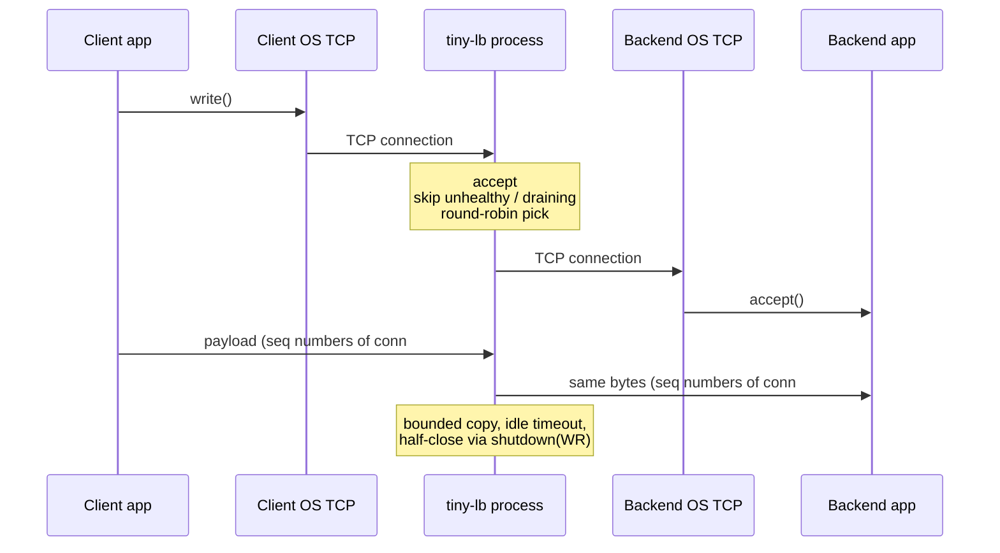

# tiny-lb

A Layer-4 TCP load balancer. Clients talk to **one** address. tiny-lb **terminates** that TCP connection, **opens another** to a healthy backend, and **copies bytes**. The kernel still owns TCP. Packets are not forwarded.

Live UI: `http://127.0.0.1:19090`

## How it works in a real system



Health probes are a **separate** `connect()` loop. They do not sit on the client path. The dashboard on `:19090` only reads the same in-process counters the proxy updates.

## Run

On this Windows box `:8080` is often blocked — use these ports.

Three terminals (fake apps):

```
cargo run -- echo 18001
cargo run -- echo 18002
cargo run -- echo 18003
```

Load balancer:

```
cargo run -- 127.0.0.1:18080 127.0.0.1:18001 127.0.0.1:18002 127.0.0.1:18003
```

Open `http://127.0.0.1:19090`

Scale (real TCP through the LB):

```
cargo run -- load 127.0.0.1:18080 500 30
```
